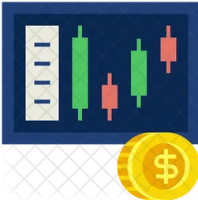
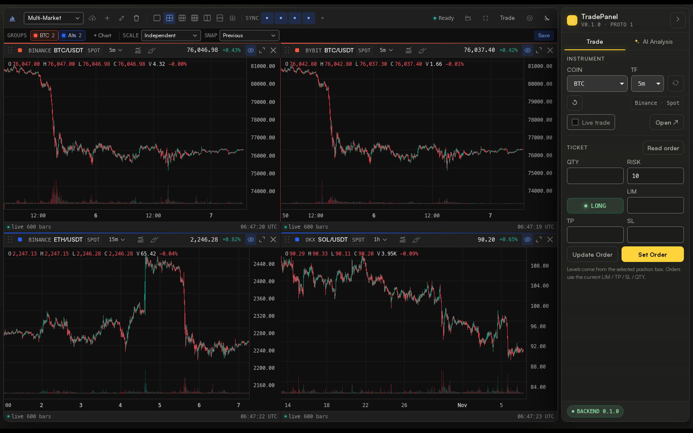
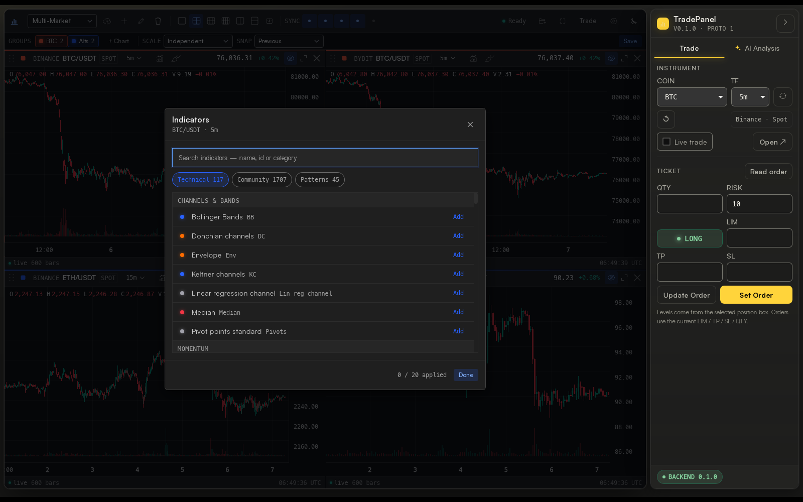
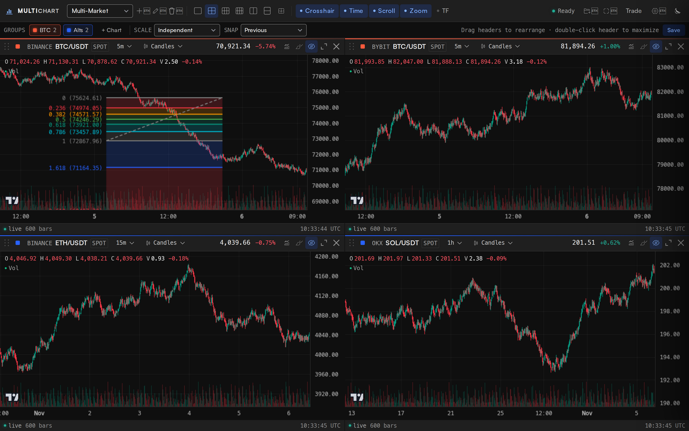
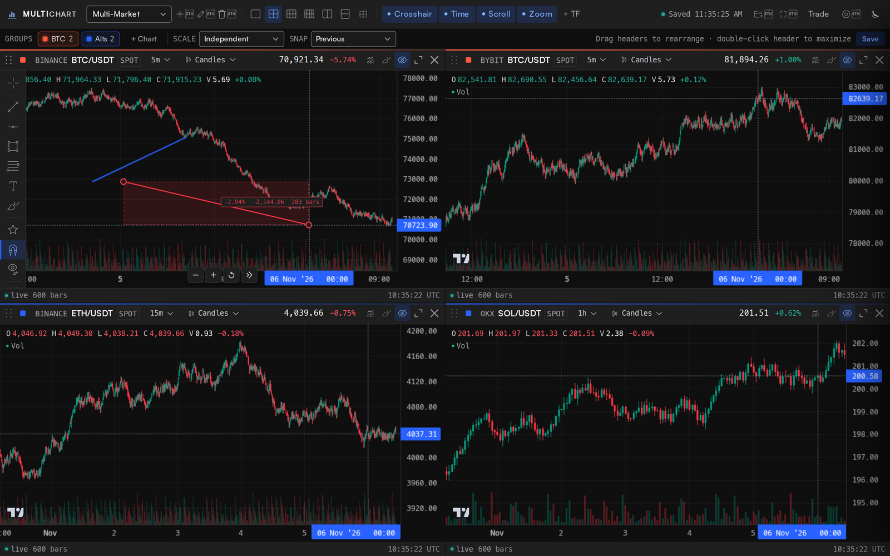
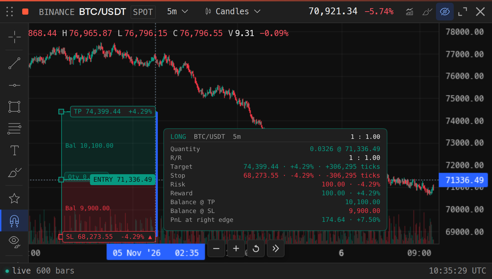
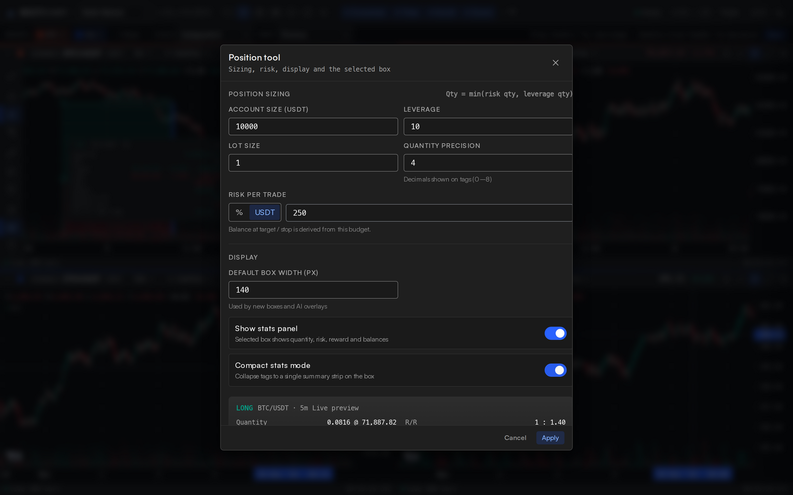
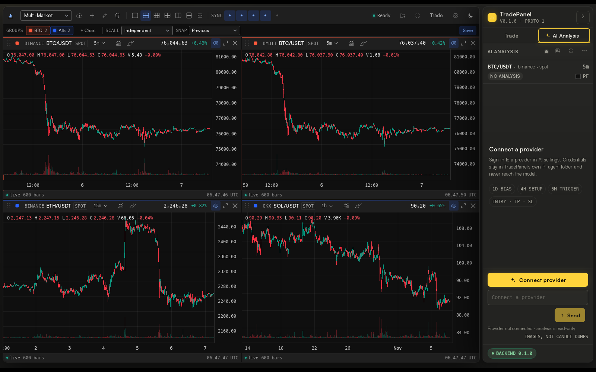
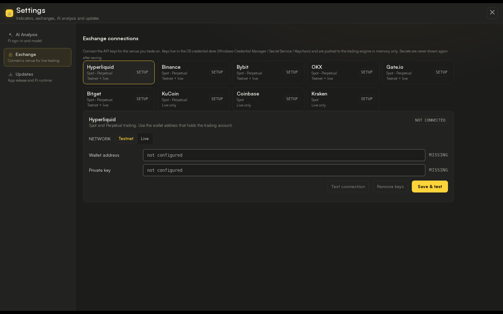
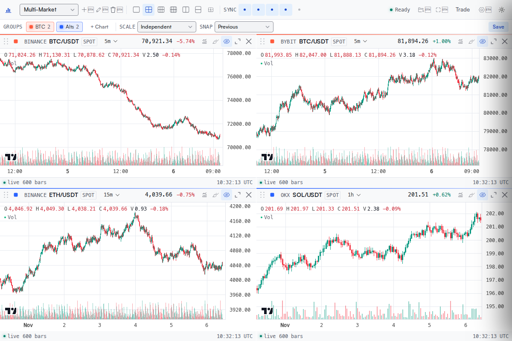

<p align="center">
  
</p>

<h1 align="center">TradePanel</h1>

<p align="center">
  <strong>One desktop terminal for multi-exchange charts, precise trade planning, and private AI analysis that sees your charts.</strong>
</p>

<p align="center">
  <a href="LICENSE"></a>
  
  
  
</p>

<p align="center">
  
  <br />
  <em>Nine exchanges, one synchronized chart workspace, and the order ticket in a single desktop window.</em>
</p>

---

## What is TradePanel?

TradePanel is a local-first crypto trading terminal for traders who watch more than
one exchange. It combines a TradingView-style multi-chart workspace, 1,869 technical
studies, 86 drawing tools, trade-planning position projections, a Hyperliquid
execution ticket, and an AI analyst that reads the charts you are actually looking
at — all in one native desktop application.

The app is built with **Tauri 2 (Rust)**. Market data, credentials, and order
execution are handled by a supervised **Python sidecar**; the chart workspace and
indicator engine run in a locked-down WebView. There is no TradePanel account, no
cloud workspace, and no relay between you and the exchange.

> **Default safety posture:** Hyperliquid starts on **testnet**. Live trading is an
> explicit, per-credential opt-in, and order submission is never retried
> automatically.

---

## Why TradePanel?

Most retail trading workflows are spread across a charting service, several exchange
tabs, a notes app, and a separate AI chat window. Every hop loses context — and every
extra tab is another place your keys or ideas can leak. TradePanel collapses that
workflow into one screen:

| The usual workflow | With TradePanel |
|---|---|
| Chart on TradingView, execute on the exchange, take notes elsewhere | Chart, plan, and execute in one window |
| Re-create the same layout for every venue | One synchronized workspace; each panel can use a different exchange |
| Copy screenshots into an AI chat and explain the context | The AI receives the current instrument's chart renders, indicators, and ticket automatically |
| Store API keys in `.env` files or browser extensions | Trading keys live in the OS credential store, never in JavaScript |
| Trust a web app with your workspace and account | Workspace, drawings, settings, and AI sessions stay on your machine |
| Pay for multi-chart layouts and indicator packs | MIT-licensed, self-hosted, no per-seat subscription |

---

## Feature tour

### One synchronized, multi-exchange chart workspace

Open 1, 2, 4, 6, 8, or a custom number of charts. Charts synchronize crosshair,
visible range, scroll, zoom, and optionally timeframe **by timestamp**, not by array
index — so a 5-minute chart and a 1-hour chart stay aligned instead of drifting.

- **Nine venues:** Binance, Bybit, OKX, Coinbase, Kraken, KuCoin, Gate.io, Bitget,
  and Hyperliquid.
- **Spot and perpetual markets** where the venue supports them.
- **Groups and layouts** with independent settings and colours per group.
- **Price-axis modes:** independent, absolute, percentage, and indexed.
- **Unsupported intervals** are aggregated locally from a lower interval and tagged
  in the timeframe menu; weekly/monthly bars use UTC calendar boundaries.

### 1,869 indicators, all running locally

Every study comes from
[`lightweight-charts-indicators`](https://github.com/deepentropy/lightweight-charts-indicators)
and is computed in the WebView from the panel's own candles.

<p align="center">
  
  <br />
  <em>Searchable picker: 117 standard studies, 1,707 community scripts, and 45 candlestick patterns.</em>
</p>

- Add up to 20 studies per chart from the searchable picker.
- Every study has an **Inputs / Style / Visibility** dialog with live preview.
- Overlays stack under the OHLC readout; oscillators get their own resizable panes.
- One legend per study pane with hide, settings, last value, and crosshair value.
- Live ticks reuse the existing series — no full chart rebuild on every update.

### Drawing tools that understand risk

TradePanel ships the 86 TradingView-parity tools from
[`lightweight-charts-drawing`](https://github.com/deepentropy/lightweight-charts-drawing)
— trend lines, channels, pitchforks, Fibonacci and Gann tools, Elliott waves, volume
profiles, patterns, text, tables, images, and more — plus custom trade-planning
layers built for this app.

<p align="center">
  
  <br />
  <em>Drawings persist per symbol and survive timeframe, chart-type, and price-mode changes.</em>
</p>

<p align="center">
  
  <br />
  <em>The measure tool reports price delta, percentage, bars, and elapsed time in one gesture.</em>
</p>

### Position boxes with live sizing and risk math

Drag a long or short position box from entry to target, and the stop mirrors 1:1 (or
click once for a 2R template). Each box carries entry, target, and stop tags with
price and signed percentage, plus quantity and account-balance tags. Selecting a box
opens a stats panel with R/R, risk, reward, balances at each exit, and open PnL. The
selected box feeds the order ticket directly.

<p align="center">
  
  <br />
  <em>Size by risk or fixed USDT, set leverage and lot precision, and see the outcome before placing the order.</em>
</p>

<p align="center">
  
  <br />
  <em>Account size, risk budget, leverage, lot size, precision, display mode, and a live preview.</em>
</p>

### AI analysis with eyes on your charts

The bundled **Pi 1.5.0** agent runs on a bundled Node 22 runtime — no Node, npm, Pi CLI,
or terminal required on the installed machine. When you start an analysis, TradePanel
renders the current instrument's **1d, 4h, and 5m** charts offscreen with the same
indicators that are visible on the focused chart, then attaches those PNGs to the
prompt.

<p align="center">
  
  <br />
  <em>AI Analysis lives beside the trade ticket and follows the focused chart's instrument and indicators.</em>
</p>

- **Images, not candle dumps.** Sending three timeframes of OHLCV as text costs tens of
  thousands of tokens; chart renders cut token use by an order of magnitude and give
  the model real structure to read.
- **Read-only by construction.** Pi gets a compact snapshot through five `panel_*`
  tools and has no shell, filesystem, network, or trading tools.
- **Validated plan card.** Every answer ends with **LONG / SHORT / NO TRADE, entry,
  take-profit, stop-loss, and R:R**. The card can fill the ticket only when you click;
  it never submits an order.
- **Sessions persist** as Pi session files and restore without restarting the agent.
- **Bring your own provider.** Pi's own OAuth/device-code or API-key flows are exposed
  under Settings → AI Analysis; 42 providers are supported in Pi 1.5.0.

### A trade ticket that stays out of the way

The right sidebar has two tabs — **Trade** and **AI Analysis** — so either workflow
owns the full column height. The Trade tab carries the instrument row, QTY/RISK,
LONG/SHORT, LIM, TP/SL, Read order, Update Order, and Set Order. Collapse it with
`Ctrl+Shift+T` and the charts take the whole window; the ticket becomes a floating
rail that parks at the edge.

### Local-first security, not security theatre

<p align="center">
  
  <br />
  <em>Settings → Exchange: venue connections, testnet/live selection, and OS-keychain credentials.</em>
</p>

- **Credentials** are stored in the OS credential store (Windows Credential Manager,
  Secret Service, or macOS Keychain). Secrets never reach JavaScript, are never echoed
  in logs, and have no plaintext fallback.
- **The renderer is untrusted.** The WebView has no shell, filesystem, or HTTP
  permissions; the CSP allows same-origin assets and IPC only.
- **Fail closed.** Missing credentials, an incompatible protocol, an unavailable
  keyring, or an unsigned update stops the relevant operation instead of degrading.
- **Order safety.** Timeouts and sidecar exits during an order produce
  `EXECUTION_UNKNOWN`, persist a lock, and require you to verify open orders before
  trading is re-enabled. Identical in-flight submissions are rejected in both the
  shell and the backend.

### Light and dark, at home on the desktop

<p align="center">
  
  <br />
  <em>Pi Scope shell tokens and a neutral chart palette, with light and dark themes persisted across sessions.</em>
</p>

---

## How TradePanel compares

| Capability | **TradePanel** | TradingView | Hyperliquid native | Exchange web terminals |
|---|---|---|---|---|
| Multi-exchange charting | **9 venues, synchronized layouts** | Yes; multi-chart on paid plans | Hyperliquid only | Single venue |
| Execution | **Hyperliquid** (testnet default, live opt-in) | Broker integrations; no native Hyperliquid | **Native Hyperliquid** | Native single venue |
| Built-in AI analysis | **Local agent + chart screenshots + validated plan** | No | No | No |
| Technical studies | **1,869 studies** | Largest library; plan limits | Basic | Basic to moderate |
| Drawing & trade planning | **86 tools + position/risk boxes** | Best-in-class charting | Basic | Limited |
| Workspace and drawing storage | **Local files** | Cloud account | Wallet / cloud | Cloud account |
| API-key storage | **OS credential store** | Browser session | Wallet | Browser session |
| Desktop app | **Native Tauri 2** | Desktop and web | Web | Web |
| Open source | **MIT** | No | No | No |
| Cost | **Free / self-hosted** | Subscription for advanced use | Free | Free |

**The honest trade-off:** TradingView still has the deeper charting ecosystem and a
much larger social/community layer. TradePanel's advantage is not "more indicators" —
it is putting **multi-venue charting, risk-first trade planning, Hyperliquid execution,
and a private AI analyst into one local desktop workflow** that you own and can modify.

---

## Who is TradePanel for?

- **Multi-venue crypto traders** who compare the same asset across Binance, Bybit,
  OKX, Hyperliquid, and others before taking a position.
- **Hyperliquid users** who want better charting, drawing, and risk planning around
  execution without moving to a different platform.
- **Discretionary traders** who plan entries, stops, and size visually and want the
  ticket to follow the plan.
- **Privacy-conscious users** who do not want a cloud workspace, browser extension, or
  third-party relay holding keys or trade ideas.
- **Developers** who want an MIT-licensed desktop trading shell they can extend.

---

## Getting started

### Prerequisites

| Requirement | Version |
|---|---|
| Rust | 1.77+ |
| Node.js | 20+ |
| Python | 3.12 |
| [uv](https://docs.astral.sh/uv/) | latest |
| Tauri Linux dependencies | `libwebkit2gtk-4.1-dev`, `libsoup-3.0-dev`, `libgtk-3-dev`, and related packages |

Full platform notes: [`docs/BUILD.md`](docs/BUILD.md). You do not need to install
these by hand: `./tradePanel` checks the platform and offers to install anything
missing on first run.

### Run from source

```bash
git clone https://github.com/NerdAtWork24X7/TradePanel.git
cd TradePanel

./tradePanel                   # checks/installs prerequisites (with consent), then launches tauri dev
./tradePanel --rebuild-backend # force a fresh PyInstaller sidecar, then launch
./tradePanel --no-install      # print install instructions instead of installing
```

On native Windows use `tradePanel.cmd` instead (cmd.exe or PowerShell):

```bat
tradePanel.cmd
```

The AI Analysis panel additionally needs the bundled Pi runtime
(`npm run ai:runtime`); the rest of the app starts without it.

Then:

1. Open **Settings** (`Ctrl+,`) → **Exchange** and connect the venues you trade.
2. Pick **Testnet** or **Live** for Hyperliquid and save credentials. Trading keys go
   to your OS credential store.
3. Open the **AI Analysis** tab and sign in to a provider if you want AI-assisted
   chart review. Provider credentials are kept separately from trading keys.
4. Build a layout, add indicators, and drag a position box. The ticket picks up its
   levels.

### Build a release

```bash
./build.sh                     # current platform: AppImage + .deb / NSIS
./build.sh --debug             # debug bundle
./build.sh --skip-backend      # reuse the staged sidecar
powershell -File backend/scripts/build-windows.ps1   # native Windows release
```

Artifacts land under `src-tauri/target/release/bundle/`.

### Run the tests

```bash
backend/scripts/test.sh        # Python, chart sync, bridge, Rust, typecheck, build
npm --prefix frontend test      # frontend contract tests
npm run test:ai                 # mock-provider AI end-to-end
```

See [`docs/TESTING.md`](docs/TESTING.md) for coverage, E2E evidence, and the manual
cross-platform checklist.

---

## Architecture at a glance

```
┌──────────────────────────── Tauri 2 shell (Rust) ────────────────────────────┐
│  Shell UI (TypeScript)  ◄──── postMessage ────►  Chart workspace iframe      │
│  trade ticket · settings · AI panel               Lightweight Charts 5.2     │
│         │ Tauri IPC (allow-listed commands + events)                         │
│  ┌──────▼───────────┐        JSON-RPC 2.0 over stdio      ┌────────────────┐ │
│  │ SidecarManager   │ ◄─────────────────────────────────► │ Python sidecar │ │
│  │ order gate       │   one UTF-8 JSON object per line     │ market data    │ │
│  │ keyring · health │                                      │ exchange I/O   │ │
│  └──────────────────┘                                      └────────────────┘ │
└───────────────────────────────────────────────────────────────────────────────┘
```

- **Rust** owns the window, process supervision, IPC allow-list, credential store,
  updates, and the order gate.
- **Python** owns exchange REST/WebSocket I/O, market-data parsing and aggregation,
  persistence, and Hyperliquid execution. It is Qt-free and runs headless.
- **TypeScript / WebView** owns the shell UI, chart workspace, indicators, drawings,
  and the AI snapshot renderer. It makes no external network requests.
- **Pi** runs as a separate supervised, read-only analysis process with a cleared
  environment and no trading credentials.

More detail: [`docs/ARCHITECTURE.md`](docs/ARCHITECTURE.md),
[`docs/IPC_PROTOCOL.md`](docs/IPC_PROTOCOL.md),
[`docs/SECURITY.md`](docs/SECURITY.md).

---

## Project layout

```
TradePanel/
├── src-tauri/       # Tauri 2 shell: commands, sidecar supervision, security, AI manager
├── frontend/        # shell UI (TypeScript + Vite) and the chart workspace in frontend/web
├── backend/         # Python sidecar, market data, exchange integrations, trading core
├── ai/runtime/      # pinned Pi runtime source
├── docs/            # architecture, IPC, security, build, testing, AI docs
├── tradePanel       # one-command dev launcher (Linux/macOS/Git Bash)
├── tradePanel.cmd   # Windows launcher (cmd.exe / PowerShell)
├── build.sh         # reproducible release build
└── logo.png
```

The chart workspace lives in exactly one place (`frontend/web`) and is served to
Tauri; there is no forked copy.

---

## Documentation

| Document | Contents |
|---|---|
| [`docs/BUILD.md`](docs/BUILD.md) | prerequisites, dev/build commands, packaging, updater, troubleshooting |
| [`docs/ARCHITECTURE.md`](docs/ARCHITECTURE.md) | process model, flows, failure handling, deviations |
| [`docs/IPC_PROTOCOL.md`](docs/IPC_PROTOCOL.md) | JSON-RPC envelope, error codes, methods, timeouts |
| [`docs/SECURITY.md`](docs/SECURITY.md) | threat model, credentials, CSP, capabilities, order safety |
| [`docs/TESTING.md`](docs/TESTING.md) | suites, E2E evidence, performance, manual checklist |
| [`docs/AI_INTEGRATION.md`](docs/AI_INTEGRATION.md) | Pi runtime, chart screenshots, tools, plan validation |
| [`docs/AI_SECURITY.md`](docs/AI_SECURITY.md) | read-only boundary, environment isolation, provider auth |
| [`docs/STANDALONE_BUILD.md`](docs/STANDALONE_BUILD.md) | runtime staging and clean-machine packaging |
| [`docs/AI_TROUBLESHOOTING.md`](docs/AI_TROUBLESHOOTING.md) | provider, runtime, rendering, and history failures |
| [`docs/UI_STANDARDS.md`](docs/UI_STANDARDS.md) | typography, icons, controls, contrast, responsiveness |

---

## Status and limitations

- **Hyperliquid defaults to testnet.** Live is available but must be enabled
  explicitly; validate live execution with a disposable account before relying on it.
- **Windows runtime validation is pending.** Scripts and packaging are included, but
  release validation has so far been done on Linux.
- **The bundle is large.** The Python sidecar is roughly 267 MB because `pandas_ta`
  needs numba; the bundled AI runtime adds roughly 200 MB.
- **AI analysis is read-only.** It can propose a plan and fill the ticket, but it can
  never submit an order or read trading credentials.
- **Absolute price sync** deliberately skips charts with an incompatible quote
  currency or scale.
- **macOS is out of scope** for the current release.

This is an early `0.1.0` release. APIs, layouts, and packaging may change.

---

## License

[MIT](LICENSE) © 2026 Sahil Vartak

TradePanel builds on excellent open-source work:
[Lightweight Charts](https://github.com/tradingview/lightweight-charts),
[`lightweight-charts-indicators`](https://github.com/deepentropy/lightweight-charts-indicators),
[`lightweight-charts-drawing`](https://github.com/deepentropy/lightweight-charts-drawing),
[Tauri](https://tauri.app/), and [Pi](https://github.com/earendil-works/pi-coding-agent).
